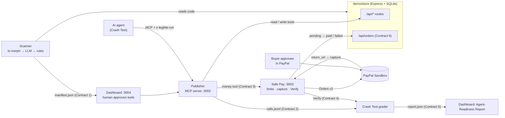

# Legible

**Make any website safely usable by AI agents, and prove it.**

AI agents are starting to shop, book and pay on the web, but websites were built for humans. An agent clicking
through HTML is fragile, and an agent with a payment API is dangerous. Legible reads a site's code, decides which
actions an agent may take and how risky each one is, publishes them as an MCP server, routes every payment through
**PayPal with human approval and spending limits**, then sends a real AI agent shopping to find what breaks.

Built for the PayPal AI Hackathon 2026. MIT licensed.

## How it works
1. **Scan**: reads the site's source and writes an agent manifest: tools with risk tiers `read` / `write` / `money`.
2. **Approve**: a human approves which tools agents get in the **dashboard** (tools start unapproved).
3. **Publish**: approved tools are served as an MCP server (Streamable HTTP). Every call is logged per run.
4. **Safe Pay**: money tools never touch card data. They create a **PayPal Sandbox order**; a human approves it in
   PayPal; Safe Pay captures, updates the store, and refuses anything over the spending limit before PayPal is called.
5. **Crash Test**: an AI agent runs shopping scenarios through the MCP server. Each payment is checked against
   PayPal's record and the store's database, and the results become an **Agent-Readiness Score**.



Modules talk only through Zod contracts in `packages/contracts` and HTTP; no app imports another.

| Folder | What |
| --- | --- |
| `packages/contracts` | Zod schemas + `ROUTES` shared by every module |
| `demo/store` | The website under test, with two planted bugs behind env flags |
| `apps/scanner` | Code → manifest (3-stage pipeline) + accuracy eval |
| `apps/publisher` | Manifest → MCP server, per-run call log |
| `apps/safepay` | PayPal Orders v2 (Sandbox), limits, capture, Verify |
| `apps/crashtest` | AI agent harness, grading, report |
| `apps/dashboard` | Next.js: approve tools, read reports (before/after) |
| `scripts/demo.ts` | `pnpm demo`: the whole golden path in one command |

## Run it (clean clone, Node 22)
```bash
nvm use                                   # Node 22 (.nvmrc); better-sqlite3 has no build for Node 23+
npm install -g pnpm@9.12.0
pnpm install
pnpm --filter @legible/safepay exec playwright install chromium   # once: sandbox approval for tests
cp .env.example .env                      # fill PayPal Sandbox app + sandbox buyer + LLM_* (see below)
pnpm validate:fixtures
pnpm demo                                 # bugs ON: the "before" report
pnpm demo --bugs off                      # bugs fixed: the "after" report
```
`pnpm demo` checks Node, `.env`, free ports (3001-3004) and Chromium; starts the store, Safe Pay, the Publisher and
the dashboard and checks each `/health`; scans `demo/store`; runs every scenario; prints the score, each scenario and
each failure plus a link to the report page; and leaves the services running (Ctrl+C stops them, or pass `--exit`).
Service logs: `runs/demo-logs/`.

`pnpm demo --manual` is the human-in-the-loop version: the scanner leaves every tool unapproved, the MCP server serves
nothing, and the demo waits while you approve tools at http://localhost:3004/tools and click **Save manifest** (the MCP
server picks the change up without a restart). Press Enter and the agent runs on exactly what you approved.

## Dashboard
| Tools: risk-grouped, approve → MCP server | Report: score, bugs ON vs OFF, evidence |
|---|---|
|  |  |

Other commands: `pnpm test` (unit, no network) · `pnpm typecheck` · `pnpm test:contracts` (one test per module join,
against running services) · `pnpm crashtest --all` · `pnpm --filter @legible/scanner eval`.

## PayPal APIs used (Sandbox only: `api-m.sandbox.paypal.com`; the client refuses any other host)
| API | Use |
| --- | --- |
| OAuth 2.0 `POST /v1/oauth2/token` (client credentials) | access token for Orders v2 |
| Orders v2 `POST /v2/checkout/orders` | `intent: CAPTURE`, `payment_source.paypal.experience_context` (`return_url` → Safe Pay, `user_action: PAY_NOW`), `PayPal-Request-Id` for idempotency; the `payer-action` link is the human approval URL |
| Orders v2 `GET /v2/checkout/orders/{id}` | Verify: compare PayPal's status / amount / currency with the store's order |
| Orders v2 `POST /v2/checkout/orders/{id}/capture` | after the buyer approves (on `return_url`); captured at most once per checkout |
| Sandbox negative testing (`PayPal-Mock-Response: INSTRUMENT_DECLINED`) | the declined-payment scenario |

Spending limits are enforced before PayPal is called: an over-limit checkout is `BLOCKED_LIMIT` and creates no
PayPal order. Crash Test approves sandbox orders as a sandbox buyer via a test-only route (`SAFEPAY_TEST_MODE=1`).
Currency is USD because the Sandbox rejected INR (`CURRENCY_NOT_SUPPORTED`).

## AI models used, and how
Any OpenAI-compatible API, configured only by `LLM_BASE_URL`, `LLM_API_KEY`, `LLM_MODEL` (each app has one helper,
`src/llm.ts`, using the `openai` SDK). Gemini (free tier) and Groq both work. The numbers below were measured with
**`openai/gpt-oss-120b` on Groq**. Free tiers rate-limit, so the helper retries 429/5xx/timeouts with exponential
backoff, and the scanner caches answers by prompt hash.

- **Scanner (stage 2):** one **forced tool call** per route (`tool_choice` names `describe_route`). It returns
  `expose`, `name`, `description`, inputs, `risk`, `riskReason` and `confidence`, validated with Zod. If a provider
  ignores the forced tool choice, the scanner falls back to JSON mode plus Zod with one repair retry. Stage 1 (route
  discovery with ts-morph) and stage 3 (risk rules) are deterministic. The LLM proposes; rules and Safe Pay binding
  decide what is safe to expose.
- **Crash Test agent:** the same model in a tool-use loop (max 25 steps) over the MCP tools. It knows nothing about
  the planted bugs.

### Scanner eval (hand-labelled ground truth, `apps/scanner/eval/`, 11 routes, 3 identical fresh runs)
| metric | pipeline | rules only | LLM only |
|---|---|---|---|
| tool precision / recall / F1 | **100% / 100% / 100%** | – | 77.8% / 100% / 87.5% |
| risk-tier accuracy (all routes) | **90.9%** | 90.9% | 100% |
| risk-tier accuracy (exposed tools) | **100%** | – | – |
| route discovery recall | 100% | | |

On its own, the LLM would expose two internal payment routes. Stage 3 removes them, because a money route that
can't be bound to Safe Pay is never exposed. The one risk miss is a cautious upgrade (`GET` order status → money),
flagged with confidence 0.57. The benchmark is small (one site, 11 routes).

## Before / after: planted bugs (store env flags, default ON in `pnpm demo`)
| Flag | Bug | Crash Test finds it as |
| --- | --- | --- |
| `BUG_COUPON_API=1` | `POST /api/cart/:cartId/coupon` returns 500 for `DIWALI20` (the web page's coupon works) | `tool_error`, then `task_failed` (the agent stops instead of overpaying) |
| `BUG_PAID_EARLY=1` | the store marks an order `paid` before PayPal captured anything | `state_mismatch`: Verify before approval shows store `paid` vs PayPal `PAYER_ACTION_REQUIRED` |

| | Score | Scenarios |
|---|---|---|
| `pnpm demo` (bugs ON) | **25/100** | buy-hoodie-coupon ✗ · declined-payment ✗ · hoodie-no-coupon ✗ · over-limit ✓ |
| `pnpm demo --bugs off` | **100/100** | all ✓: 2 PayPal captures, 1 decline, 1 `BLOCKED_LIMIT` ($321 > $100, no PayPal order) |

Money scenarios count double in the score. Verify runs before approval and again after PayPal, because the
paid-early bug is invisible once the capture completes.

## Team
Rules for every coding agent: `AGENTS.md`. Briefs: `docs/briefs/`. Progress log: `docs/progress.md`. Video script: `docs/demo-script.md`.
